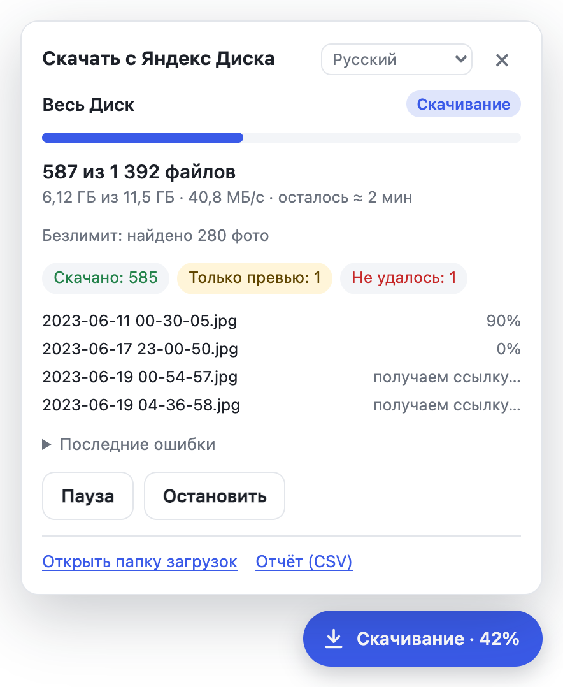
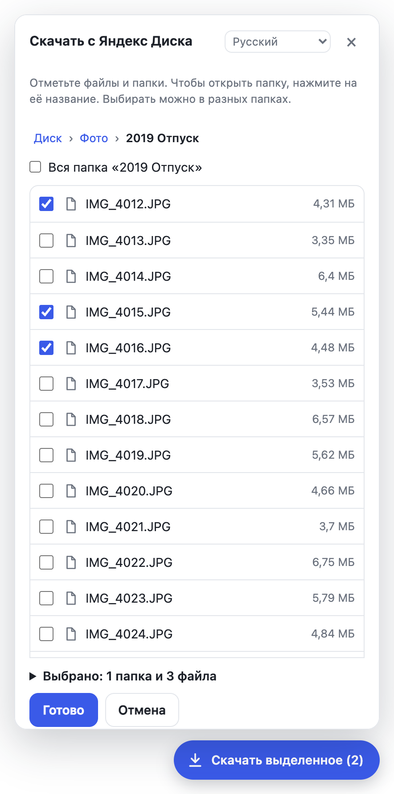
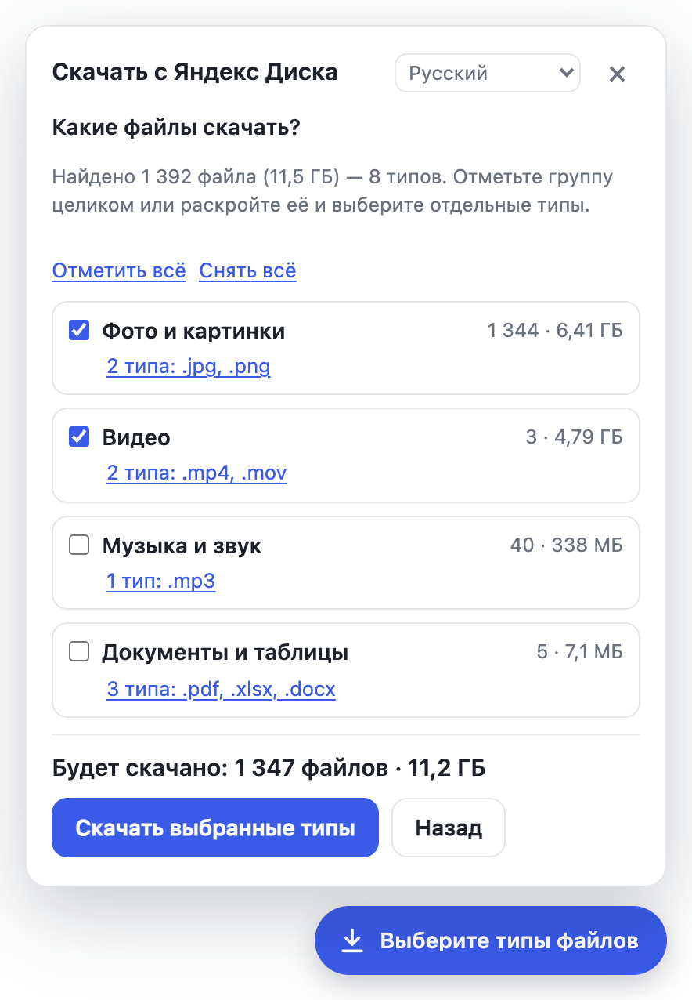
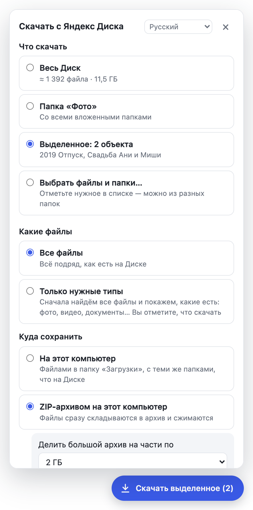
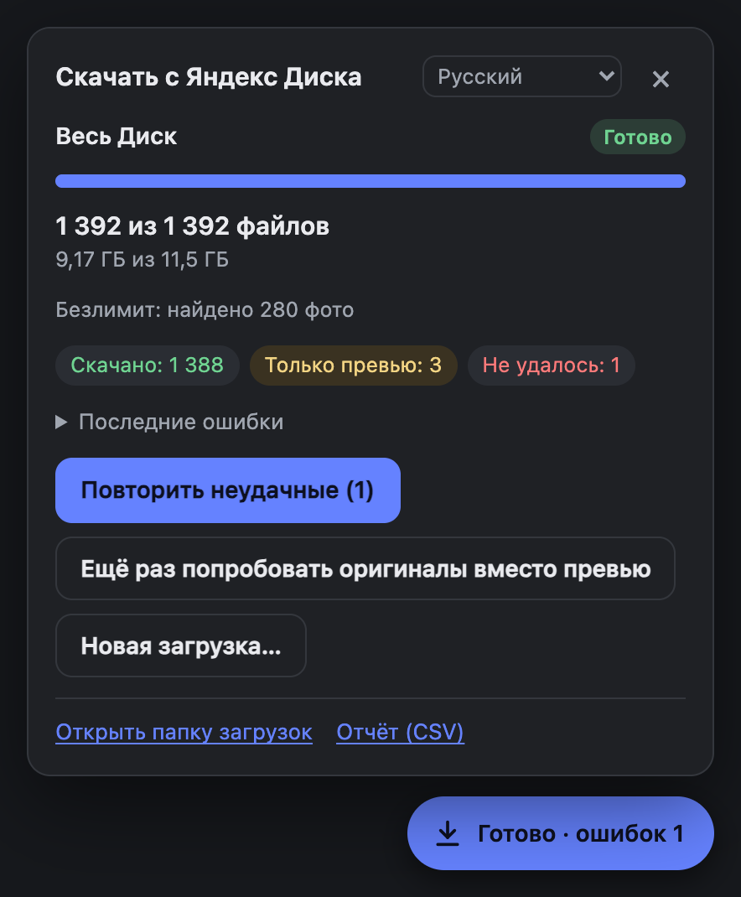

# Скачать всё с Яндекс Диска

Неофициальное расширение для Chrome, Яндекс Браузера, Edge и других браузеров на Chromium. Возвращает кнопку «Скачать» для **всего Диска, папки, выделенных файлов и публичных ссылок**. Файлы скачиваются по одному со всеми папками, складываются в ZIP-архив или переносятся в другое облако. Интерфейс — на 23 языках.

> Расширение не связано с Яндексом. Оно делает то же, что можно сделать вручную: нажимает «Скачать» у каждого файла по очереди.

**Простая инструкция по шагам:** [на русском](guide/ru.md). Сайт проекта: [verhogladov.github.io/yandex-disk-download-all](https://verhogladov.github.io/yandex-disk-download-all/).

**На вашем языке:** [English](guide/en.md) · [Українська](guide/uk.md) · [Беларуская](guide/be.md) · [Қазақша](guide/kk.md) · [Oʻzbekcha](guide/uz.md) · [Кыргызча](guide/ky.md) · [Тоҷикӣ](guide/tg.md) · [Türkmençe](guide/tk.md) · [Azərbaycanca](guide/az.md) · [Հայերեն](guide/hy.md) · [ქართული](guide/ka.md) · [Română](guide/ro.md) · [Татарча](guide/tt.md) · [Башҡортса](guide/ba.md) · [Чӑвашла](guide/cv.md) · [Саха тыла](guide/sah.md) · [Нохчийн](guide/ce.md) · [Ирон](guide/os.md) · [Буряад](guide/bxr.md) · [Удмурт](guide/udm.md) · [Qaraqalpaqsha](guide/kaa.md) · [Qırımtatarca](guide/crh.md)

## Зачем это нужно

11 октября 2026 года Яндекс отключил в веб-версии Диска массовое скачивание. Нельзя скачать папку, несколько файлов сразу, альбом или «Скачать всё» по публичной ссылке. Причина — повреждённый дата-центр и необходимость снизить нагрузку ([Медуза](https://meduza.io/news/2026/10/11/yandeks-ogranichil-skachivanie-faylov-iz-svoego-oblachnogo-hranilischa-yandeks-disk-chtoby-sohranit-rabotosposobnost-drugih-servisov-posle-ataki-na-data-tsentr), [URA.RU](https://ura.news/news/1053135260)). Скачать один файл по-прежнему можно.

Отключено было серверное создание ZIP-архивов, а не скачивание отдельных файлов. Расширение архивы у Яндекса не запрашивает. Оно обходит папки и скачивает каждый файл отдельно, тем же запросом, что и обычная кнопка «Скачать» у одного файла. Если нужен архив, расширение собирает его само, прямо в браузере.


## Установка (2 минуты)

1. Скачайте [`yandex-disk-download-all.zip`](https://github.com/verhogladov/yandex-disk-download-all/releases/latest/download/yandex-disk-download-all.zip) со страницы [релизов](https://github.com/verhogladov/yandex-disk-download-all/releases) и распакуйте. Получится папка `yandex-disk-download-all`, внутри неё лежит файл `manifest.json`. Не удаляйте эту папку: браузер берёт расширение из неё.
2. Откройте страницу расширений:
   - Chrome — `chrome://extensions`
   - Яндекс Браузер — `browser://extensions`
   - Edge — `edge://extensions`, Opera — `opera://extensions`, Brave — `brave://extensions`, Vivaldi — `vivaldi://extensions`
3. Включите **«Режим разработчика»** (переключатель вверху страницы).
4. Нажмите **«Загрузить распакованное расширение»** и выберите распакованную папку.
5. **Обязательно:** в настройках браузера выключите **«Всегда указывать место для скачивания»** (Chrome: «Настройки → Скачанные файлы»). Иначе браузер спросит, куда сохранить каждый файл.

Обновление: распакуйте новый архив поверх той же папки с заменой файлов и нажмите круглую стрелку у расширения на странице расширений.

### Где работает

| Браузер | Работает ли |
| --- | --- |
| Google Chrome | Работает. Проверено на настоящем Диске (2 177 файлов, 25 ГБ: папки, ZIP, выбор типов, перерыв посреди скачивания, файл на 937 МБ) и автотестами в обычном Chrome и Chrome for Testing. |
| Яндекс Браузер, Edge, Opera, Brave, Vivaldi | Должно работать: тот же движок Chromium, установка такая же. Отдельно не проверялось — если что-то не так, [напишите](https://github.com/verhogladov/yandex-disk-download-all/issues). |
| Firefox | Пока нет. В Firefox расширения устроены иначе: нет фоновых service worker и offscreen-документов, на которых держатся ZIP-архив и перенос в облако. Нужен отдельный порт. |
| Safari | Нет: в Safari у расширений нет API загрузок. |
| Телефоны | Нет. В мобильных Chrome и Safari расширения не ставятся. Реальный путь на Android — версия для Firefox: в Firefox для Android есть нужный API загрузок и каталог дополнений. На iPhone вариантов нет. |

Окно расширения и страница настроек проверены и на узком экране (360 px) на всех языках.

## Как пользоваться

1. Откройте [Яндекс Диск](https://disk.yandex.ru/client/disk) и войдите в аккаунт.
2. Справа внизу появится кнопка. Её подпись зависит от того, где вы находитесь:
   - **«Скачать весь Диск»** — в корне «Файлов»;
   - **«Скачать папку»** — внутри папки;
   - **«Скачать выделенное (N)»** — если выделены файлы или папки;
   - **«Скачать всё»** — на странице публичной ссылки.
3. Выберите, что скачать, и нажмите **«Начать скачивание»**.
4. Файлы появятся в папке «Загрузки → Яндекс Диск» с той же структурой папок, что на Диске. Файлы из публичных ссылок попадут в «Яндекс Диск/Публичные ссылки».



### Выбрать, что скачать

Нужно не всё, а отдельные файлы и папки — отметьте их прямо в панели. В блоке «Что скачать» нажмите **«Выбрать файлы и папки…»**: откроется список Диска. Галочка отмечает файл или папку целиком, нажатие на название папки открывает её. Выбирать можно в разных папках: например, папку «Свадьба» и пару фото из «Отпуска». Внизу видно, сколько выбрано; там же можно убрать лишнее. Нажмите «Готово», затем «Начать скачивание». Скачать выбранное можно файлами, ZIP-архивом или в облако.

Можно и по-старому: выделить файлы на самом сайте Диска. Тогда кнопка станет «Скачать выделенное (N)».



### Только нужные типы файлов

В блоке «Какие файлы» выберите **«Только нужные типы»**. Расширение сначала найдёт все файлы и покажет, что у вас есть: сколько фото, видео, документов и сколько они весят. Отметьте группы целиком или отдельные расширения — скачаются только они. Выбор можно поменять и после начала: «Изменить типы…».



Вкладку с Диском можно свернуть, но не закрывайте её до конца. Если вкладка закрылась или браузер перезапустился, откройте Диск снова. В первые 10 минут загрузка продолжится сама, позже — по кнопке «Продолжить». Уже скачанное заново не качается.

## ZIP-архив вместо отдельных файлов

В блоке «Куда сохранить» выберите **«ZIP-архивом на этот компьютер»**. Файлы скачиваются с Яндекса и сразу складываются в архив прямо в браузере, папки внутри архива сохраняются. Так можно скачать выделенные файлы одним архивом, как раньше.



- **Что внутри.** Выделенные файлы лежат в корне архива, папка — одной папкой, весь Диск — со всей структурой. Если выбрано из разных папок, внутри архива будут папки от их общего начала, например «Фото/2019» и «Документы». Даты изменения файлов берутся с Диска.
- **Сжатие.** Документы, таблицы и текст сжимаются, часто в разы. Фото и видео уже сжаты, поэтому кладутся в архив как есть: архив с ними весит почти столько же, сколько сами файлы. Галочка «Сжимать и фото с видео» заставляет сжимать всё, но выигрыш обычно в пределах нескольких процентов, а времени уходит заметно больше.
- **Части.** Большой архив сохраняется частями по 1, 2 или 4 ГБ: «…, часть 1.zip», «…, часть 2.zip». Каждая часть — обычный ZIP, она открывается сама по себе. Если всё поместилось в одну часть, получится один файл без номера. Файл крупнее части (например, длинное видео) ложится в отдельную часть своего размера. Часть «4 ГБ» помещается и на флешку с FAT32.
- **Временное место.** Пока часть собирается, браузер держит её во временной папке на диске компьютера. Пока часть сохраняется, нужно примерно вдвое больше места, чем её размер. Если места мало, выберите части поменьше или перенос в облако.
- **Если браузер закрыли.** Уже сохранённые части остаются. Несохранённая часть пропадает, и при продолжении её файлы скачаются заново.
- Файлы больше 4 ГБ записываются в формате ZIP64. Его открывают проводник Windows 10 и 11, «Архиватор» macOS, 7-Zip, WinRAR и unzip.

## Перенос в облако или на свой сервер

Если на компьютере не хватает места, файлы можно отправлять сразу в другое хранилище. На компьютер они не сохраняются: каждый файл скачивается с Яндекса и тут же уходит дальше через браузер. Структура папок сохраняется.

Поддерживаются:

- **WebDAV**: Nextcloud, ownCloud, свой сервер или NAS (Synology, QNAP), Hetzner Storage Box, Koofr, pCloud и другие;
- **S3-совместимые хранилища**: Selectel, Yandex Object Storage, Cloudflare R2, Backblaze B2, свой MinIO и другие.

Как подключить:

1. В панели расширения нажмите «Подключить облако или сервер (WebDAV, S3)…». Откроется страница настроек.
2. Выберите тип хранилища, укажите адрес и данные для входа. Примеры адресов есть на этой же странице.
3. Нажмите «Проверить подключение». Расширение запишет и удалит пробный файл. Браузер попросит разрешить доступ к вашему серверу — разрешите.
4. Нажмите «Сохранить», вернитесь на вкладку Диска и в блоке «Куда сохранить» выберите подключённое хранилище.

Что учесть:

- Логин, пароль и ключи хранятся только в этом браузере. Используйте пароль приложения или ключ с доступом только к одному бакету.
- Через ваш интернет файл проходит дважды: скачивается с Яндекса и отправляется в хранилище.
- В WebDAV каждый файл отправляется одним запросом, поэтому браузер сначала собирает его целиком во временном хранилище. Для очень больших видео нужно временное место размером с сам файл. В S3 большие файлы уходят частями по 8 МБ, такого ограничения нет.
- Google Drive, Dropbox и OneDrive напрямую пока не поддерживаются: для каждого из них нужно регистрировать приложение у сервиса. Тем, кто умеет работать в терминале, поможет [rclone](https://rclone.org/commands/rclone_serve_webdav/): `rclone serve webdav` раздаёт любое облако по WebDAV.

## Что важно знать

- **Не все файлы могут скачаться.** После аварии часть узлов хранения Яндекса не отвечает. Такие файлы помечаются «Не удалось». Нажмите «Повторить неудачные» позже: во втором проходе расширение ждёт ответа сервера дольше.
- **Превью вместо оригинала.** Если оригинал фото не отдаётся, расширение сохраняет самое большое доступное превью с пометкой «(превью)» в имени. Это не оригинал. Позже можно нажать «Ещё раз попробовать оригиналы вместо превью». Если эта возможность не нужна, отключите её в «Настройках».
- **«Безлимит для фото».** Фото из безлимита не видны в разделе «Файлы». Если они у вас есть, отметьте «Добавить фото из „Безлимита“». Расширение найдёт их через раздел «Фото» и сохранит в папку «Фото из безлимита».
- **Отчёт.** Кнопка «Отчёт (CSV)» сохраняет список файлов, которые не скачались, с причинами. Файл открывается в Excel и Google Таблицах.
- **Место на компьютере.** Убедитесь, что его хватит. Чтобы качать на внешний диск, укажите его как папку загрузок в настройках браузера.
- **Опасные типы файлов** (`.exe`, `.msi` и т. п.) браузер может попросить подтвердить вручную в списке загрузок.
- **Корзина** не скачивается. Сначала восстановите из неё нужное.
- **Пустые папки** на компьютере не создаются: браузер создаёт папки только для файлов.
- **Имена файлов.** Символы, недопустимые в Windows (`: * ? " < > |` и т. п.), заменяются на `_`. Если два имени различаются только регистром, ко второму добавляется « (2)».



## Бережно к серверам Яндекса

Серверы Яндекса сейчас работают с ограничениями. По умолчанию расширение качает 4 файла одновременно и делает паузы между запросами. Если Яндекс ответит «слишком много запросов», расширение само подождёт. Не увеличивайте число одновременных загрузок без необходимости.

## Если что-то не так

| Что происходит | Что делать |
| --- | --- |
| Кнопка не появилась | Обновите страницу Диска (F5). Проверьте, что расширение включено. |
| Браузер спрашивает, куда сохранить каждый файл | Выключите «Всегда указывать место для скачивания», затем нажмите «Продолжить». |
| «Нужно заново войти в Яндекс» / «Сессия устарела» | Обновите страницу (F5): загрузка продолжится. |
| «Яндекс просит пройти проверку» | Нажмите «Пройти проверку», затем «Продолжить». |
| «Эта загрузка уже идёт в другой вкладке» | Задание качается в другой вкладке Диска. Закройте лишнюю вкладку. |
| Многие файлы «Не удалось» | Сервер Яндекса их сейчас не отдаёт. Повторите позже. |
| «Не удалось сохранить архив» или «не хватает временного места» | Освободите место на диске компьютера и нажмите «Продолжить». Если не помогло, начните заново с частями поменьше. |
| Яндекс изменил сайт, и ничего не работает | Расширение использует внутренний API веб-версии Диска. Если его поменяют, нужно обновление. |

## Языки

Интерфейс переведён на 23 языка: русский, английский, украинский, белорусский, казахский, узбекский, киргизский, таджикский, туркменский, азербайджанский, армянский, грузинский, румынский (Молдова), татарский, башкирский, чувашский, якутский, чеченский, осетинский, бурятский, удмуртский, каракалпакский и крымскотатарский. Язык выбирается в верхней строке окна расширения. По умолчанию — язык браузера, если он есть в списке, иначе русский. Название и описание в списке расширений переведены на 11 языков, которые есть в самом Chrome.

Переводы с русского сделаны без носителей языков, в малых языках возможны неточности. Исправления очень нужны: словарь интерфейса — `extension/locales/<код>.json`, инструкция — `guide/<код>.md`. Проверка словаря: `node scripts/check-locales.js <код>` (все строки на месте, подстановки `{…}` совпадают, нет слов со смешанными алфавитами).

## Конфиденциальность

- Расширение работает только на страницах Яндекс Диска и использует вашу сессию в этом браузере. Пароль и токены оно не запрашивает и не хранит.
- Запросы уходят только на серверы Яндекса. Аналитики и сторонних серверов нет.
- Прогресс хранится в браузере (`chrome.storage.local`), чтобы загрузку можно было продолжить.

Разрешения: «Управление скачиваниями» нужно, чтобы сохранять файлы. Доступ к серверам Яндекса, с которых скачиваются файлы (`*.disk.yandex.ru`, `*.storage.yandex.net` и т. п.), нужен, чтобы проверять ссылку коротким запросом, когда серверы Яндекса начинают зависать, и чтобы переносить файлы в облако. `cloud-api.yandex.net` — запасной путь для публичных ссылок. Доступ к вашему облаку или серверу расширение запрашивает только при его подключении. Перенос в облако и сборку архива выполняет невидимая служебная страница (offscreen).

## Другие способы

- Программа «Яндекс Диск» для компьютера — официальный способ. По [справке Яндекса](https://yandex.ru/support/yandex-360/customers/disk/web/ru/actions-files/download-all) для этого нужна подписка Яндекс 360.
- [yandex-disk-rescue](https://github.com/KenGuru66/yandex-disk-rescue) — rclone и отладочный токен Полигона, для тех, кто готов работать в терминале.
- [YaDiskDownloader](https://github.com/murzirius/YaDiskDownloader) — программа для Windows на официальном REST API.

## Для разработчиков

```
extension/
  manifest.json        Manifest V3
  _locales/            название и описание расширения для списка расширений браузера
  locales/             словари интерфейса, по файлу на язык; ru.json — исходный
  background.js        chrome.downloads, перенос в облако, блокировка «одно задание — одна вкладка»
  options.html         страница настроек облака или сервера
  offscreen.html       служебная страница: перенос в облако и сборка ZIP-архива
  src/util.js          имена файлов по правилам chrome.downloads, пути, форматирование
  src/i18n.js          перевод строк, множественное число, запись чисел по языку
  src/private-api.js   внутренний API веб-версии: POST /models-v2?m=<метод>
  src/public-api.js    публичные ссылки: cloud-api.yandex.net/v1/disk/public/resources
  src/storage.js       задание в chrome.storage.local частями по 1000 файлов
  src/engine.js        обход папок, очередь, повторы, запасные варианты, продолжение
  src/destinations.js  WebDAV и S3 (подпись AWS SigV4, загрузка частями)
  src/transfer.js      скачивание с Яндекса с отправкой в облако или в архив, без записи отдельных файлов на диск
  src/zip.js           ZIP: CRC-32, сжатие deflate, ZIP64, UTF-8 имена, даты в UTC
  src/options.js       проверка и сохранение настроек облака
  src/ui.js            кнопка и панель (Shadow DOM)
  src/content.js       сборка всего на странице Диска
guide/                 простая инструкция для всех, по файлу на язык
site/index.html        сайт проекта (scripts/build-site.sh собирает docs/index.html для GitHub Pages)
scripts/               сборка архива и сайта, скриншоты, проверка переводов
tests/
  unit.test.js         node --test tests/
  e2e/run.js           Chrome против поддельного Диска, WebDAV и S3
  e2e/layout.js        вёрстка окна на всех языках, на компьютере и телефоне
```

Как это устроено:

- Расширение использует тот же API, что и сайт: `POST /models-v2?m=<метод>` с телом `{sk, connection_id, apiMethod, requestParams}`. `sk` и `idClient` берутся из `<script id="preloaded-data">` страницы. Когда сервер отвечает `CKEY`, `sk` заменяется новым.
- Список папки — `mpfs/resources` (`{idContext, sort: "name", order: "1", amount: 40, offset}`), как у сайта.
- Ссылка на файл — `mpfs/url` (`{path}`). Это тот же запрос, что делает кнопка «Скачать» у одного файла. Серверный ZIP (`mpfs/bulk-download-prepare`) не используется.
- Запасные варианты для фото: прямая ссылка `ORIGINAL` из `mpfs/info`, затем самое большое превью.
- Безлимит: `intapi/photo-init-snapshot` → `intapi/photo-get-snapshot` → `intapi/photo-get-clusters-with-resources`.
- Файлы сохраняет сам браузер через `chrome.downloads` по одному. Если сервер не отвечает или скачивание остановилось, загрузка отменяется по таймауту и файл помечается для повтора.
- `chrome.downloads.download()` возвращает id только после ответа сервера, поэтому запрос к молчащему серверу отменить нельзя: он занимает одно из шести соединений браузера с сервером. После первого такого случая фоновый скрипт проверяет каждую ссылку запросом `fetch` на 1 байт, который можно прервать, и только потом начинает загрузку. Без этого несколько «мёртвых» файлов подряд останавливали всё скачивание; это проверяет отдельный автотест.
- Архив собирает offscreen-документ. Он скачивает файл через `fetch`, считает CRC-32 и, если тип файла сжимается, пропускает его через `CompressionStream('deflate-raw')`. Сжатый вариант остаётся, только если он меньше исходного. Данные хранятся как `Blob`, поэтому большие файлы браузер держит во временной папке на диске, а не в памяти. Часть закрывается, когда следующий файл перевалил бы за выбранный размер. Тогда собираются центральный каталог (ZIP64, если нужно) и blob-ссылка, а фоновый скрипт сохраняет часть через `chrome.downloads`. Пока часть не сохранена, её файлы в задании имеют отдельный статус. После перезагрузки страницы движок сверяется с offscreen-документом, а если части пропали вместе с браузером, скачивает их файлы заново.
- При переносе в облако файл скачивает offscreen-документ (`fetch` с куками сессии) и сразу отправляет его через `fetch` с `credentials: 'omit'`. XMLHttpRequest здесь не подходит: на ответ 401 браузер показывает своё окно логина, и в невидимом документе перенос зависает. Подпись S3 сверяется с примерами из документации AWS и с независимой библиотекой aws4.

Тесты:

```
node --test tests/                       # 39 модульных тестов, архивы проверяются ещё и unzip и Python zipfile
node scripts/check-locales.js            # все 22 перевода против русского словаря
cd tests/e2e && npm install && npm test  # 117 проверок в настоящем Chrome: поддельный Диск, ZIP-архив, WebDAV, S3 (s3rver), языки
npm run layout                           # 368 видов окна: 23 языка × 8 экранов × компьютер и телефон
```

`CHROME_PATH=/путь/к/браузеру npm test` запускает те же проверки в другом браузере на Chromium, например в обычном Google Chrome. Поддельный Диск отвечает на `disk.yandex.ru` только внутри тестового браузера, в интернет ничего не уходит.

Сайт проекта: исходник — `site/index.html`, картинки — в `docs/`. Команда `scripts/build-site.sh` собирает `docs/index.html`. Чтобы опубликовать сайт, в настройках репозитория на GitHub откройте Pages и выберите ветку `main` и папку `/docs`. Кнопки «Поддержать» и «Помощь со скачиванием» появятся, когда в начале скрипта страницы (объект `SITE`) будут указаны ссылки. Скриншоты для сайта делает `NODE_PATH=tests/e2e/node_modules node scripts/screenshots.js` (сначала `npm install` в `tests/e2e`).

Лицензия — MIT.
