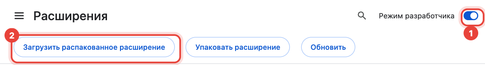
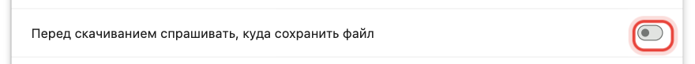

# Яндекс Дискера дерриг а муха чуяккха

Атта инструкци. Пхеа минот гергга хан оьшу.

*Оьрсийн маттера гочдина — нисдарш [GitHub](https://github.com/verhogladov/yandex-disk-download-all/issues) тӀехула хьажийча, баркалла боху вай.*

**ХӀун хилла.** 2026 шеран 11 октябрера дуьйна Яндекс Дискан сайтехь папка, масех файл я берриге Диск цкъа чуяккха йиш яц — цхьацца бен. «Яндекс Дискера дерриг а чуяккха» цӀе йолчу мах боцчу браузеран шорбаларо «Чуяккха» кнопка юхаялайо: цо шена файлаш цхьацца чуйохуш, Дискехь санна папкашка дӀайохку.

**ХӀун оьшу:**

- компьютер я ноутбук (Windows, macOS я Linux);
- Google Chrome я Яндекс Браузер (Edge, Opera, Brave, Vivaldi а дика ду);
- компьютерехь мукъа меттиг — Дискехь мел дӀалаьцна ю, оццул.

Телефонехь болх ца бо: мобильни браузерашкахь иштта шорбалар хӀоттаза. Компьютер оьшу.

## 1-ра гӀулч. Шорбалар чуяккха

1. ТӀетаӀа: **[yandex-disk-download-all.zip чуяккха](https://github.com/verhogladov/yandex-disk-download-all/releases/latest/download/yandex-disk-download-all.zip)**. Файл «Загрузки» папкехь Ӏалашлур ю.
2. Архивера схьаяккха:
   - **Windows:** файл тӀехь мышкан аьтту кнопка тӀетаӀа → «Извлечь все…» (дерриг схьаяккха) → «Извлечь»;
   - **macOS:** файл тӀехь шозза тӀетаӀа.
3. `yandex-disk-download-all` папка гуьра ю. Иза новкъарло йоцчу меттиге, масала «Документы» папке дӀаяккха. ТӀаьхьа ма дӀаяккха: браузеро шорбалар оцу папкера схьаоьцу.

## 2-гӀа гӀулч. Шорбалар браузере хӀоттаде

**Google Chrome**

1. Адресан могӀане `chrome://extensions` яздай, Enter тӀетаӀа.
2. Лакхара аьтту маьӀиг тӀехь **«Режим разработчика»** (кхоллархочун режим) латаде.
3. Лакхара аьрру маьӀиг тӀера хьалхара кнопка тӀетаӀа — **«Загрузить распакованное расширение»** (схьайиллина шорбалар чуяккха).
   
4. `yandex-disk-download-all` папка харжа (чохь `manifest.json` файл йолу папка).
5. МогӀамехь «Скачать всё с Яндекс Диска» шорбалар гуьра ю. Кийча ю.

**Яндекс Браузер** — иштта, адрес бен ца хийцало: `browser://extensions`.

**Edge, Opera, Brave, Vivaldi** — адресаш `edge://extensions`, `opera://extensions`, `brave://extensions`, `vivaldi://extensions`, тӀаккха иштта: «Режим разработчика» → «Загрузить распакованное».

> «Режим разработчика» — иза гӀуллакх ду: туьканера доцу шорбаларш иштта хӀиттайо. Шорбалар мах боцуш ю, цуьнан код схьайиллина ю. Браузер дӀайолалуш иштта шорбаларш дӀайайа аьлла хаттахь — дӀа ма ло.

## 3-гӀа гӀулч. «Мича Ӏалашдан» хаттар дӀадайа

Цу тӀе браузеро хӀора файлах лаьцна хоттур ду, уьш эзарнаш хила тарло.

- **Chrome:** `chrome://settings/downloads` схьаелла, **«Перед скачиванием спрашивать, куда сохранить файл»** (даима Ӏалашдеш долу меттиг хатта) дӀадайа.
  
- **Яндекс Браузер:** «Настройки» → «Инструменты» → «Загруженные файлы» → **«Всегда спрашивать, куда сохранять файлы»** билгало дӀаяккха.
- **Кхин браузераш:** нисдаршкахь, чуяхкаран декъехь, хӀора файл мича Ӏалашйо хаттар дӀадайа.

## 4-гӀа гӀулч. Файлаш чуяха

1. [disk.yandex.ru](https://disk.yandex.ru) схьаелла, хьайн аккаунте гӀо. Диск хьалха а схьайиллина елахь — агӀо карлаяккха (F5).
2. Лахара аьтту маьӀиг тӀехь сийна **«Берриге Диск чуяккха»** кнопка гуьра ю. Папкан чохь цуьнан цӀе «Папка чуяккха» ю, файлаш билгалъяхахь — «Билгалдинарг чуяккха».
   
3. Иза тӀетаӀа. Кор схьайоьллу:
   - **«ХӀун чуяккха»** — берриге Диск, хӀара папка, билгалдинарг я могӀамера «Файлаш а, папкаш а харжа…»;
   - **«Муьлха файлаш»** — дерриг а я «Оьшу тайпанаш бен» (масала, суьрташ а, видео а бен);
   - **«Мича Ӏалашдан»** — компьютере Дискехь санна файлашца, цхьа ZIP-архив санна я кхечу марха.
4. **«Чуяккха доло»** тӀетаӀа, хьоьжуш Ӏа. Корехь гуш ду мел чуяьккхина.

*Суьртехь — оьрсийн интерфейс. Мотт коран лакхарчу могӀанехь хоржу: 23 мотт бу, нохчийн а бу.*

**Чуяккхар долуш** Дискан агӀо жимъяккха мега, амма иза **ма къовла**. АгӀо къевлинехь я компьютер дӀайайнехь — Диск юха схьаелла, «ДӀадахьа» тӀетаӀа. Чуяьккхинаргаш юха чу ца йохку.

**Файлаш мичахь ю:** «Загрузки» → «Яндекс Диск», Дискехь санна папкашкахь.

## Цхьа хӀума ца хилахь

| ХӀун гуш ду | ХӀун дан деза |
| --- | --- |
| Сийна кнопка яц | Дискан агӀо карлаяккха (F5). `chrome://extensions` чохь шорбалар латийна юй хьажа. |
| Браузеро хӀора файл мича Ӏалашйо хоттуш ду | 3-гӀа гӀулч а йина, «ДӀадахьа» тӀетаӀа. |
| Цхьаболчу файлашна «Ца хилла» | Яндексан серверша хӀинца дерриг а ца ло. Цхьа-ши сахьт даьлча «Ца хиллачарна юха хьажа» тӀетаӀа. Ишттачу файлийн могӀам «Отчёт (CSV)» кнопкано Ӏалашбо. |
| Компьютерехь меттиг кӀезиг ю | Дакъошкахь «ZIP-архив», марха дӀаяккхар я браузеран нисдаршкахь арахьара диск чуяхкаран папка санна харжа. |
| «Яндекса таллам чекхбаккха боху» | «Таллам чекхбаккха» тӀетаӀа, робот цахилар гайта, тӀаккха «ДӀадахьа» тӀетаӀа. |
| Суьртан цӀарехь «(хьалха-хьажар)» ду | Оригинал ца елла, жимйина копи Ӏалашйина. ТӀаьхьа «Хьалха-хьажарна метта оригиналаш юха хьажа» тӀетаӀа. |

## Иза кхерам боцуш дуй?

- Шорбаларо Яндекс Дискан сайтехь бен, хьан браузерехь бен болх ца бо. Яндексан пароль ца хоттуш ю. Хьан файлаш цхьанхьа а ца дахьа — ахьа ша тӀетоьхначу мархах сов.
- Иза Яндексан программа яц, код схьайиллина йолу шена йолу мах боцу проект ю.

## Муха дӀаяккха я карлаяккха

- **ДӀаяккха:** `chrome://extensions` → шорбалар улло «Удалить». Чуяьхна файлаш дуьсу.
- **Карлаяккха:** архив юха чуяккха (1-ра гӀулч), шира папкан тӀе файлаш хийцуш схьаяккха, тӀаккха `chrome://extensions` чохь шорбалар уллорчу горгачу стрелкина тӀетаӀа.

## ГӀо оьший?

[Проектан хаттарийн агӀонгахь](https://github.com/verhogladov/yandex-disk-download-all/issues) яздай (мах боцу GitHub аккаунт оьшу). ХӀун дора, хӀун гира дийца; скриншото дукха гӀо до.
