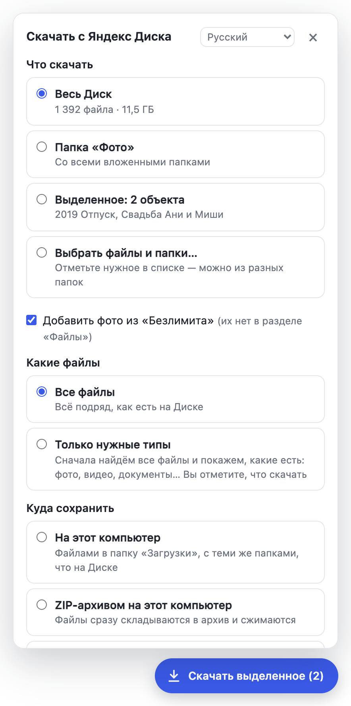

# Яндекс Дискран пурне те мӗнле тиесе илмелле

Ансат ертӳлӗх. Пилӗк минут яхӑн вӑхӑт иле.

*Вырӑс чӗлхинчен куҫарнӑ — тӳрлетӳсене [GitHub](https://github.com/verhogladov/yandex-disk-download-all/issues) урлӑ ярсан, тав тӑвӑпӑр.*

**Мӗн пулнӑ.** 2026 ҫулхи юпа уйӑхӗн 11-мӗшӗнчен пуҫласа Яндекс Диск сайтӗнче папкӑна, темиҫе файла е пӗтӗм Диска пӗр харӑсах тиесе илме май ҫук — пӗрерӗн кӑна. «Яндекс Дискран пурне те тиесе ил» ятлӑ тӳлевсӗр браузер анлӑлӑхӗ «Тиесе ил» кнопкӑна каялла тавӑрать: вӑл файлсене пӗрерӗн хӑех тиесе илет те Дискри пекех папкӑсене вырнаҫтарать.

**Мӗн кирлӗ:**

- компьютер е ноутбук (Windows, macOS е Linux);
- Google Chrome е Яндекс Браузер (Edge, Opera, Brave, Vivaldi та юрӗҫ);
- компьютерта пушӑ вырӑн — Дискра миҫе вырӑн йышӑннӑ, ҫавӑн чухлех.

Телефонра ӗҫлемест: мобиллӗ браузерсене ҫакӑн пек анлӑлӑх лартма ҫук. Компьютер кирлӗ.

## 1-мӗш утӑм. Анлӑлӑха тиесе илӗр

1. Пусӑр: **[yandex-disk-download-all.zip тиесе ил](https://github.com/verhogladov/yandex-disk-download-all/releases/latest/download/yandex-disk-download-all.zip)**. Файл «Загрузки» папкӑна упранать.
2. Ӑна архивран кӑларӑр:
   - **Windows:** файл ҫине шӑшин сылтӑм кнопкипе пусӑр → «Извлечь все…» (пурне те кӑлар) → «Извлечь»;
   - **macOS:** файл ҫине икӗ хут пусӑр.
3. `yandex-disk-download-all` папка тухать. Ӑна чӑрмантарман ҫӗре, сӑмахран «Документы» папкӑна куҫарӑр. Кайран ан хуратӑр: браузер анлӑлӑха ҫак папкӑран илет.

## 2-мӗш утӑм. Анлӑлӑха браузера лартӑр

**Google Chrome**

1. Адрес йӗркине `chrome://extensions` ҫырӑр та Enter пусӑр.
2. Ҫӳлти сылтӑм кӗтесре **«Режим разработчика»** (аталантаракан режимӗ) куҫаркӑча ҫутӑр.
3. Ҫӳлти сулахай кӗтесри пӗрремӗш кнопка ҫине пусӑр — **«Загрузить распакованное расширение»** (уҫнӑ анлӑлӑха тие).
4. `yandex-disk-download-all` папкӑна суйлӑр (ӑшӗнче `manifest.json` файл выртакан папкӑна).
5. Списокра «Скачать всё с Яндекс Диска» анлӑлӑх тухать. Хатӗр.

**Яндекс Браузер** — ҫавӑн пекех, адресӗ кӑна `browser://extensions`.

**Edge, Opera, Brave, Vivaldi** — адрессем `edge://extensions`, `opera://extensions`, `brave://extensions`, `vivaldi://extensions`, малалла ҫавӑн пекех: «Режим разработчика» → «Загрузить распакованное».

> «Режим разработчика» — ку йӗркеллӗ япала: лавккаран мар анлӑлӑхсене ҫапла лартаҫҫӗ. Анлӑлӑх тӳлевсӗр, унӑн кочӗ уҫӑ. Браузер хута янӑ чухне ҫакӑн пек анлӑлӑхсене сӳнтерме сӗнсен — килӗшмӗр.

## 3-мӗш утӑм. «Ӑҫта упрамалла» ыйтӑва сӳнтерӗр

Унсӑрӑн браузер кашни файл ҫинчен ыйтӗ, вӗсем вара пинӗ-пинӗ пулма пултараҫҫӗ.

- **Chrome:** `chrome://settings/downloads` уҫӑр та **«Всегда указывать место для скачивания»** (яланах упрамалли вырӑна ыйт) тенине сӳнтерӗр.
- **Яндекс Браузер:** «Настройки» → «Инструменты» → «Загруженные файлы» → **«Всегда спрашивать, куда сохранять файлы»** паллӑ илӗр.
- **Ытти браузерсем:** ӗнерлевсен тиевсен пайӗнче кашни файла ӑҫта упрамалли ҫинчен ыйтӑва сӳнтерӗр.

## 4-мӗш утӑм. Файлсене тиесе илӗр

1. [disk.yandex.ru](https://disk.yandex.ru) уҫӑр та хӑвӑрӑн аккаунта кӗрӗр. Диск маларах уҫӑ пулсан — страницӑна ҫӗнетӗр (F5).
2. Аялти сылтӑм кӗтесре кӑвак **«Пӗтӗм Диска тиесе ил»** кнопка тухать. Папка ӑшӗнче вӑл «Папкӑна тиесе ил» ятлӑ, файлсене палӑртсан — «Палӑртнине тиесе ил».
3. Ун ҫине пусӑр. Чӳрече уҫӑлать:
   - **«Мӗне тиесе илмелле»** — пӗтӗм Диск, ҫак папка, палӑртни е списокран «Файлсемпе папкӑсене суйла…»;
   - **«Мӗнле файлсем»** — пурте е «Кирлӗ тӗссем кӑна» (сӑмахран, сӑн ӳкерчӗксемпе видео кӑна);
   - **«Ӑҫта упрамалла»** — компьютера Дискри пекех файлсемпе, пӗр ZIP-архивпа е урӑх пӗлӗте.
4. **«Тиеме пуҫла»** кнопка ҫине пусӑр та кӗтӗр. Чӳречере миҫе тиесе илни курӑнать.

*Ӳкерчӗкре — вырӑсла интерфейс. Чӗлхене чӳречен ҫӳлти йӗркинче суйлаҫҫӗ: 23 чӗлхе пур, чӑвашла та пур.*

**Тиев пынӑ чух** Диск кантӑкне пӗчӗклетме юрать, анчах ӑна **ан хупӑр**. Кантӑк хупӑнсан е компьютер сӳнсен — Диска ҫӗнӗрен уҫӑр та «Малалла тӑс» кнопка ҫине пусӑр. Тиесе илнӗ файлсене тепӗр хут тиемест.

**Файлсем ӑҫта:** «Загрузки» → «Яндекс Диск», Дискри пекех папкӑсемпе.

## Темӗн пулмасан

| Мӗн курӑнать | Мӗн тумалла |
| --- | --- |
| Кӑвак кнопка ҫук | Диск страницине ҫӗнетӗр (F5). `chrome://extensions` ӑшӗнче анлӑлӑх ҫутӑ пулнине тӗрӗслӗр. |
| Браузер кашни файла ӑҫта упрамаллине ыйтать | 3-мӗш утӑма тӑвӑр та «Малалла тӑс» пусӑр. |
| Хӑш-пӗр файлсем «Пулмарӗ» | Яндекс серверӗсем халӗ пурне те памаҫҫӗ. Пӗр-икӗ сехетрен «Пулманнисене тепӗр хут ту» пусӑр. Ҫакӑн пек файлсен списокне «Отчёт (CSV)» кнопка упрать. |
| Компьютерта вырӑн сахал | Пайсем ҫине пайланӑ «ZIP-архив», пӗлӗте куҫарни е браузер ӗнерлевӗсенче тулашри диска тиевсен папки вырӑнне суйлӑр. |
| «Яндекс тӗрӗслеве иртме ыйтать» | «Тӗрӗслеве ирт» пусӑр, робот маррине ҫирӗплетӗр, унтан «Малалла тӑс» пусӑр. |
| Сӑн ӳкерчӗк ятӗнче «(малтанхи курӑну)» пур | Тӗп копине паман, пӗчӗклетнӗ копине упранӑ. Кайрах «Малтанхи курӑну вырӑнне тӗп кописене тепӗр хут хӑтланса пӑх» пусӑр. |

## Ку хӑрушӑ мар-и?

- Анлӑлӑх Яндекс Диск сайтӗнче кӑна тата сирӗн браузерта кӑна ӗҫлет. Яндекс парольне ыйтмасть. Сирӗн файлсене нихӑҫта та ямаҫҫӗ — хӑвӑр ҫыхӑнтарнӑ пӗлӗтрен пуҫне.
- Ку Яндекс программи мар, кочӗ уҫӑ, хӑй тӗллӗн ӗҫлекен тӳлевсӗр проект.

## Мӗнле хуратмалла е ҫӗнетмелле

- **Хуратма:** `chrome://extensions` → анлӑлӑх ҫумӗнчи «Удалить». Тиесе илнӗ файлсем юлаҫҫӗ.
- **Ҫӗнетме:** архива ҫӗнӗрен тиесе илӗр (1-мӗш утӑм), кивӗ папка ҫине файлсене улӑштарса кӑларӑр, унтан `chrome://extensions` ӑшӗнче анлӑлӑх ҫумӗнчи ҫаврака йӗпе пусӑр.

## Пулӑшу кирлӗ-и?

[Проектӑн ыйтусен страницине](https://github.com/verhogladov/yandex-disk-download-all/issues) ҫырӑр (тӳлевсӗр GitHub аккаунчӗ кирлӗ). Мӗн тунине тата мӗн курнине каласа парӑр; скриншот питӗ пулӑшать.
