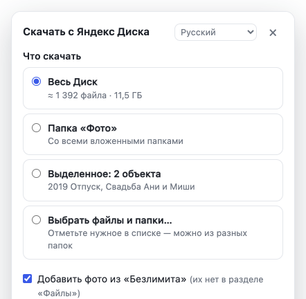

# Yandex Diskdan hammasini qanday yuklab olish mumkin

Oddiy yoʻriqnoma. Taxminan besh daqiqa vaqt oladi.

*Rus tilidan tarjima — tuzatishlarni [GitHub](https://github.com/verhogladov/yandex-disk-download-all/issues) orqali yuborsangiz, xursand boʻlamiz.*

**Nima boʻldi.** 2026-yil 11-oktabrdan boshlab Yandex Disk saytida jildni, bir nechta faylni yoki butun Diskni birdaniga yuklab olib boʻlmaydi — faqat bittadan. Bepul brauzer kengaytmasi «Yandex Diskdan hammasini yuklab olish» «Yuklab olish» tugmasini qaytaradi: u fayllarni bittadan oʻzi yuklab oladi va Diskdagi kabi jildlarga joylaydi.

**Nima kerak:**

- kompyuter yoki noutbuk (Windows, macOS yoki Linux);
- Google Chrome yoki Yandex Brauzer (Edge, Opera, Brave, Vivaldi ham mos keladi);
- kompyuterda boʻsh joy — taxminan Diskda qancha band boʻlsa, shuncha.

Telefonda ishlamaydi: mobil brauzerlarga bunday kengaytmani oʻrnatib boʻlmaydi. Kompyuter kerak.

## 1-qadam. Kengaytmani yuklab oling

1. Bosing: **[yandex-disk-download-all.zip yuklab olish](https://github.com/verhogladov/yandex-disk-download-all/releases/latest/download/yandex-disk-download-all.zip)**. Fayl «Yuklanmalar» jildiga saqlanadi.
2. Uni arxivdan chiqaring:
   - **Windows:** faylni sichqonchaning oʻng tugmasi bilan bosing → «Hammasini chiqarish…» («Извлечь все…») → «Chiqarish»;
   - **macOS:** faylni ikki marta bosing.
3. `yandex-disk-download-all` jildi paydo boʻladi. Uni xalaqit bermaydigan joyga, masalan «Hujjatlar»ga oʻtkazing. Keyin oʻchirmang: brauzer kengaytmani shu jilddan oladi.

## 2-qadam. Kengaytmani brauzerga oʻrnating

**Google Chrome**

1. Manzil satriga `chrome://extensions` deb yozing va Enter bosing.
2. Yuqori oʻng burchakda **«Dasturchi rejimi»** (ruscha «Режим разработчика», inglizcha Developer mode) kalitini yoqing.
3. Yuqori chap burchakdagi birinchi tugmani bosing — **«Ochilgan kengaytmani yuklash»** (ruscha «Загрузить распакованное расширение», inglizcha Load unpacked).
4. `yandex-disk-download-all` jildini tanlang (ichida `manifest.json` fayli boʻlgan jild).
5. Roʻyxatda «Yandex Diskdan hammasini yuklab olish» paydo boʻladi. Tayyor.

**Yandex Brauzer** — xuddi shunday, faqat manzil `browser://extensions`.

**Edge, Opera, Brave, Vivaldi** — manzillar `edge://extensions`, `opera://extensions`, `brave://extensions`, `vivaldi://extensions`, keyin xuddi shunday: «Dasturchi rejimi» → «Ochilgan kengaytmani yuklash».

> «Dasturchi rejimi» — bu odatiy hol: doʻkondan boʻlmagan kengaytmalar shunday oʻrnatiladi. Kengaytma bepul, kodi ochiq. Agar brauzer ishga tushganda bunday kengaytmalarni oʻchirishni taklif qilsa — rad eting.

## 3-qadam. «Qayerga saqlash» savolini oʻchiring

Aks holda brauzer har bir fayl haqida soʻraydi, ular esa minglab boʻlishi mumkin.

- **Chrome:** `chrome://settings/downloads` sahifasini oching va **«Har bir faylni qayerga saqlashni soʻrash»** bandini oʻchiring (ruscha «Перед скачиванием спрашивать, куда сохранить файл»).
- **Yandex Brauzer:** «Настройки» → «Инструменты» → «Загруженные файлы» → **«Всегда спрашивать, куда сохранять файлы»** belgisini olib tashlang.
- **Boshqa brauzerlar:** sozlamalarning yuklanmalar boʻlimida har bir faylni qayerga saqlash haqidagi savolni oʻchiring.

## 4-qadam. Fayllarni yuklab oling

1. [disk.yandex.ru](https://disk.yandex.ru) saytini oching va akkauntingizga kiring. Disk avvaldan ochiq boʻlsa — sahifani yangilang (F5).
2. Pastki oʻng burchakda koʻk **«Butun Diskni yuklab olish»** tugmasi paydo boʻladi. Jild ichida u «Jildni yuklab olish» deb ataladi, fayllarni belgilasangiz — «Belgilanganni yuklab olish».
3. Uni bosing. Oyna ochiladi:
   - **«Nimani yuklab olish»** — butun Disk, shu jild, belgilanganlar yoki roʻyxatdan «Fayl va jildlarni tanlash…»;
   - **«Qaysi fayllar»** — hammasi yoki «Faqat kerakli turlar» (masalan, faqat foto va video);
   - **«Qayerga saqlash»** — kompyuterga Diskdagi kabi fayllar sifatida, bitta ZIP-arxiv sifatida yoki boshqa bulutga.
4. **«Yuklashni boshlash»** tugmasini bosing va kuting. Oynada qanchasi yuklanganini koʻrish mumkin.

*Rasmda — ruscha interfeys. Til oynaning yuqori satrida tanlanadi: 23 ta til bor, oʻzbekcha ham.*

**Yuklash davomida** Disk varagʻini yigʻib qoʻyish mumkin, lekin uni **yopmang**. Agar varaq yopilib qolsa yoki kompyuter oʻchib qolsa — Diskni qayta oching va «Davom etish» tugmasini bosing. Yuklab boʻlingan fayllar qayta yuklanmaydi.

**Fayllar qayerda:** «Yuklanmalar» → «Yandex Disk», Diskdagi kabi jildlar boʻyicha.

## Agar biror narsa chiqmasa

| Nima koʻrinadi | Nima qilish kerak |
| --- | --- |
| Koʻk tugma yoʻq | Disk sahifasini yangilang (F5). `chrome://extensions` da kengaytma yoqilganini tekshiring. |
| Brauzer har bir faylni qayerga saqlashni soʻraydi | 3-qadamni bajaring va «Davom etish» tugmasini bosing. |
| Ayrim fayllar «Muvaffaqiyatsiz» | Yandex serverlari hozir hammasini bermayapti. Bir-ikki soatdan keyin «Muvaffaqiyatsizlarini takrorlash» tugmasini bosing. Bunday fayllar roʻyxatini «Hisobot (CSV)» tugmasi saqlaydi. |
| Kompyuterda joy kam | Qismlarga boʻlingan «ZIP-arxiv», bulutga koʻchirish yoki brauzer sozlamalarida tashqi diskni yuklanmalar jildi sifatida tanlang. |
| «Yandex tekshiruvdan oʻtishni soʻraydi» | «Tekshiruvdan oʻtish» tugmasini bosing, robot emasligingizni tasdiqlang, soʻng «Davom etish»ni bosing. |
| Foto nomida «(oldindan koʻrish)» bor | Asl nusxa berilmadi, kichraytirilgan nusxasi saqlandi. Keyinroq «Oldindan koʻrish oʻrniga asl nusxalarni yana sinab koʻrish» tugmasini bosing. |

## Bu xavfsizmi?

- Kengaytma faqat Yandex Disk saytida va faqat sizning brauzeringizda ishlaydi. Yandex parolini soʻramaydi. Fayllaringiz hech qayerga yuborilmaydi — oʻzingiz ulagan bulutdan tashqari.
- Bu Yandex dasturi emas, balki kodi ochiq mustaqil bepul loyiha.

## Qanday oʻchirish yoki yangilash mumkin

- **Oʻchirish:** `chrome://extensions` → kengaytma yonidagi «Olib tashlash». Yuklab olingan fayllar qoladi.
- **Yangilash:** arxivni qayta yuklab oling (1-qadam), eski jild ustiga fayllarni almashtirib chiqaring, soʻng `chrome://extensions` da kengaytma yonidagi dumaloq strelkani bosing.

## Yordam kerakmi?

[Loyihaning savollar sahifasiga](https://github.com/verhogladov/yandex-disk-download-all/issues) yozing (bepul GitHub akkaunti kerak). Nima qilganingizni va nimani koʻrganingizni yozing; skrinshot juda yordam beradi.
